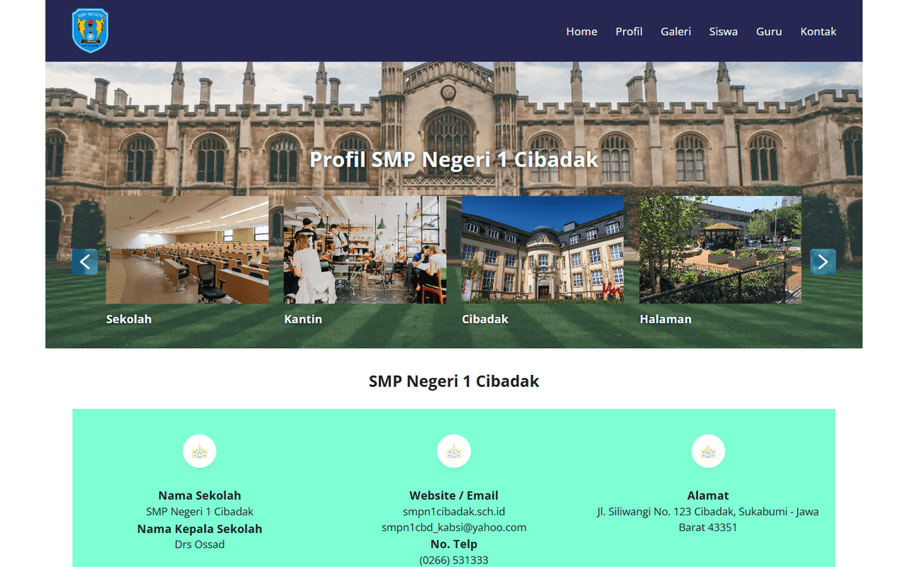

# School Profile Page – Responsive Figma Practice (fiqma6)

[](https://codelady-ship.github.io/fiqma6-responsivlik-task/fiqma6.html)

A responsive one-page school profile ("Profil SMP Negeri 1 Cibadak"), built with HTML, CSS and a little JavaScript from a Figma design as a responsive-layout practice task. The page content is in Indonesian, as in the design.

> **Practice project.** This is a learning task based on a Figma design. It is not the school's official website.
>
> 🇦🇿 Təlim layihəsi: Figma dizaynı əsasında HTML, CSS və JavaScript ilə hazırlanmış responsiv məktəb profili səhifəsi.



## Features

- Hero with a photo gallery (previous/next arrows, scroll-snap, swipe on touch)
- School information cards (CSS Grid)
- Two accessible data tables: students per class (with `colspan`/`rowspan` headers) and teachers/staff by education level
- Footer with address and in-page links
- Hamburger menu on small screens (`aria-expanded`, closes on link click and Escape)
- Responsive layout tested at 390, 600, 768, 1440 and 1920 px; wide tables scroll inside their own box on phones
- Self-hosted Open Sans font via `@font-face`
- Photos converted to WebP (two 7.5 MB PNGs became 70 KB and 145 KB)
- SEO basics: title, meta description, canonical URL, Open Graph/Twitter tags, favicon, `robots.txt`, `sitemap.xml`

## Tech stack

HTML5, CSS3 (Grid, Flexbox, media queries, `clamp()`), vanilla JavaScript.

## Run locally

No build step is needed.

```bash
git clone https://github.com/codelady-ship/fiqma6-responsivlik-task.git
cd fiqma6-responsivlik-task
# open fiqma6.html in a browser, or serve the folder:
npx serve .
```

## Project structure

```
fiqma6.html      main page
index.html       redirects the root URL to fiqma6.html
fiqma6.css       base styles
responsive.css   media queries
fiqma6.js        hamburger menu and gallery arrows
foto/            images (photos in WebP)
font-family/     Open Sans font files
```

## Deployment

GitHub Pages serves the `main` branch from the repository root, so every push to `main` updates the live site:
https://codelady-ship.github.io/fiqma6-responsivlik-task/

## What I learned

- Building valid tables: every cell inside a `<tr>`, `<thead>`/`<tbody>`, and `colspan`/`rowspan` for grouped headers
- `calc()` needs spaces around `+`, and `font` shorthand needs a size and a family (`font: 1.2rem "Open Sans"`), so a named `font-family` is clearer
- Replacing fixed `margin-left`/`padding-left` values with Grid and Flexbox so the layout works on every screen width
- Making a hamburger menu work with a few lines of JavaScript
- Compressing large images to WebP
